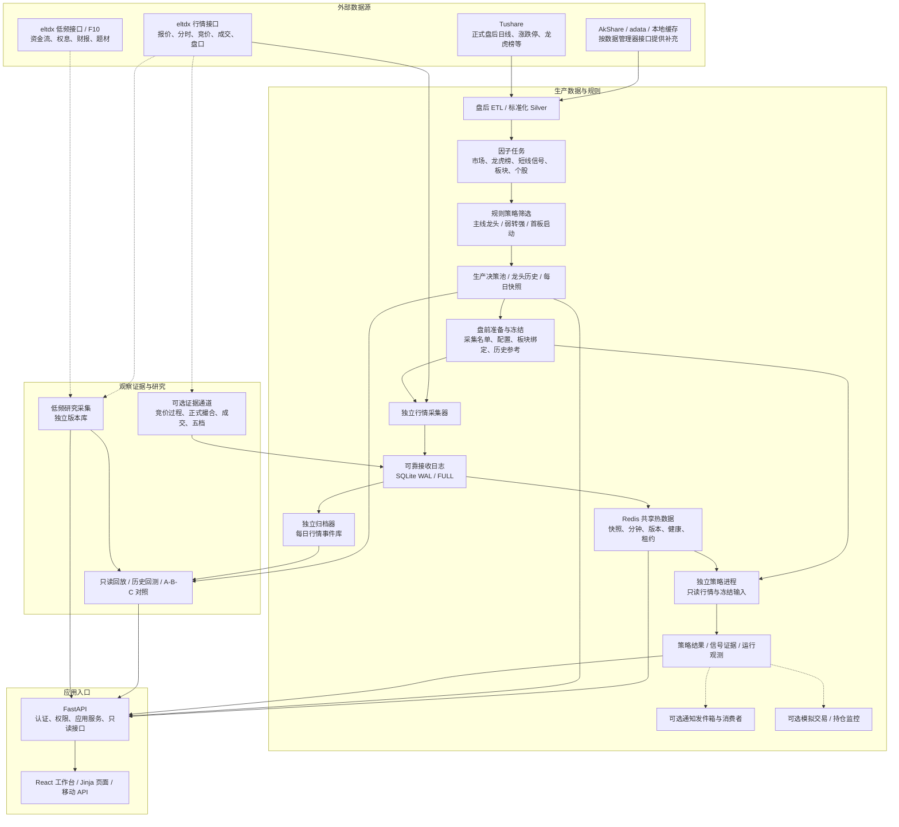
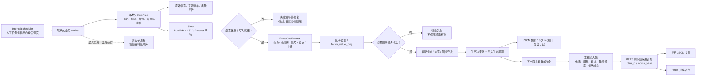
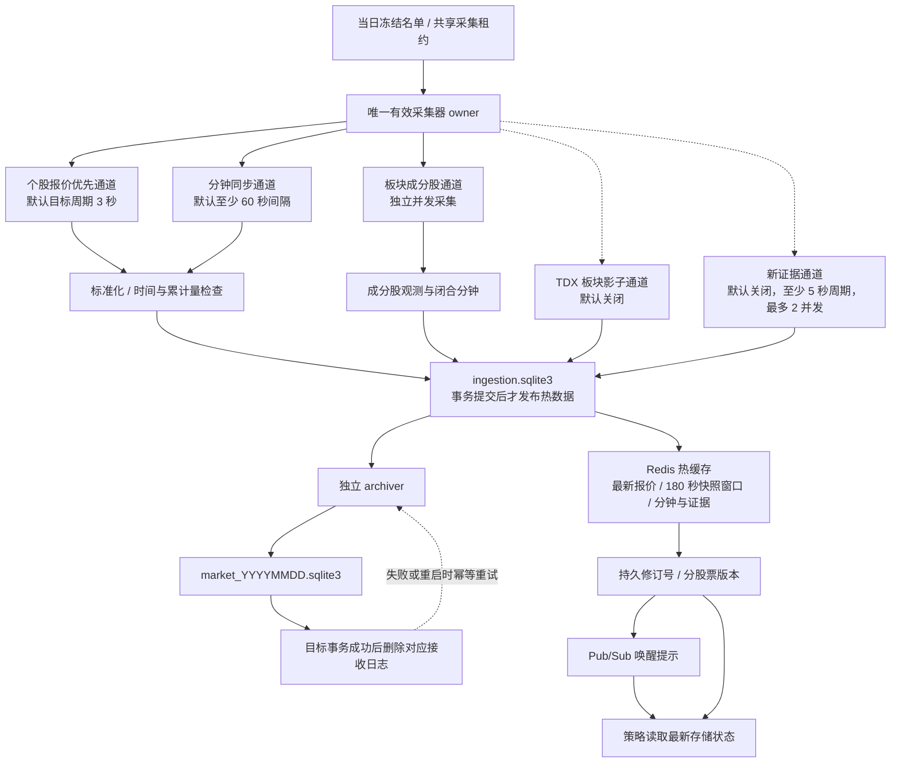
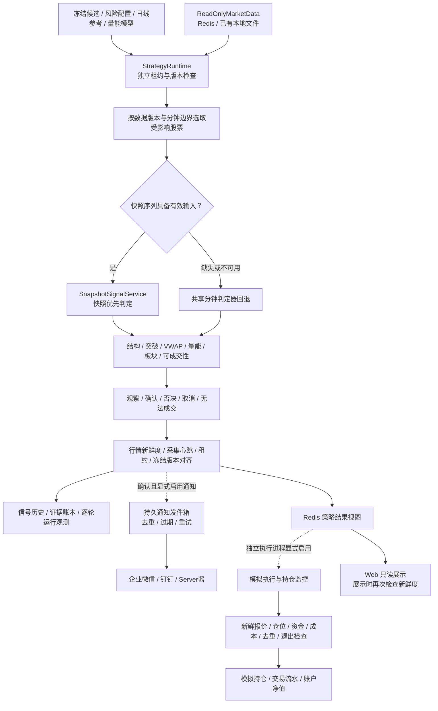
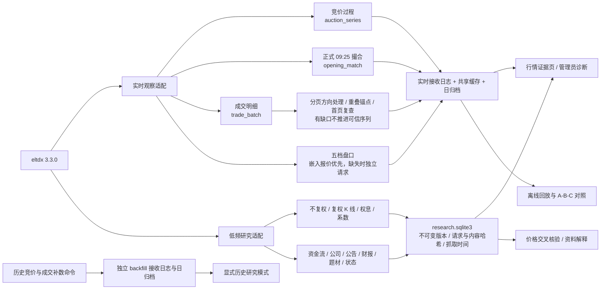
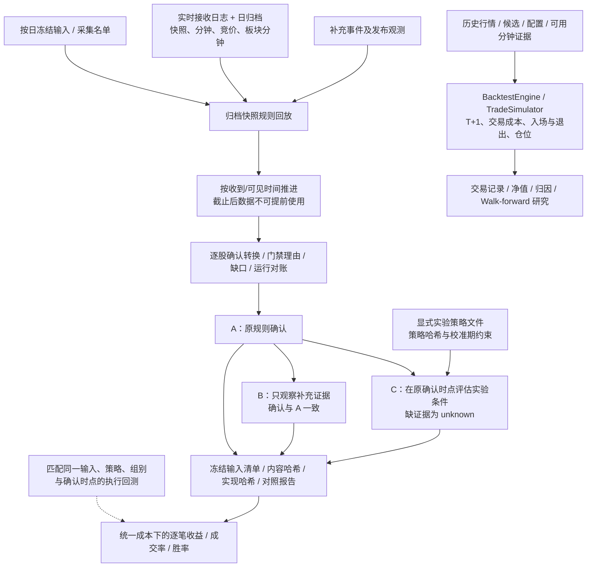
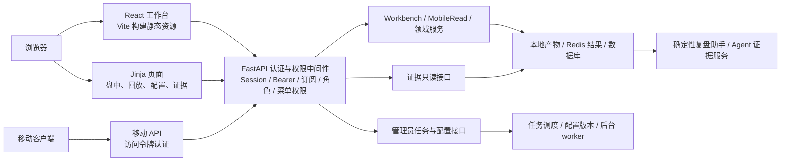
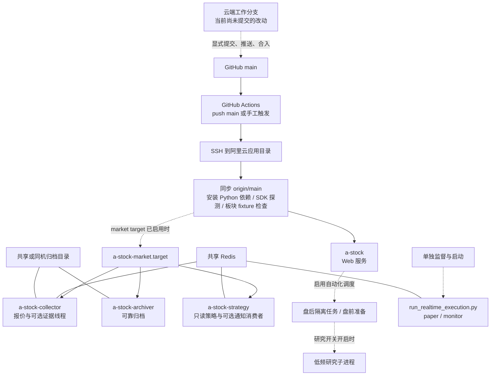

**A 股复盘与策略系统：当前工作区架构**

整理日期：2026-10-24（北京时间）。依据当前云端工作区：提交 `3e9c39a` 及尚未提交的 eltdx 第一至七阶段改动。本文描述代码结构与调用边界；服务器实际部署版本、进程状态和真实数据源连通性尚未核对。

图中实线表示数据读写/调用关系，虚线表示可选通道或离线反馈。图中存在某模块，不表示它已经开启。

**1. 整体架构图**

生产主线以规则策略运行。机器学习训练、相似样本、实验过滤与资料解释属于研究能力；新增 F10、资金流、五档和成交证据尚未作为新的正式买点门禁。

**2. 盘后数据与盘前冻结**

盘前冻结采用真实交易日历和上一交易日候选。个股采集名单是近 10 日龙头池前 30 只与生产决策池候选的去重并集；不会为凑数量添加股票。板块成分股报价名单单独维护，不自动成为买点池。

名单外持仓会被标记为未采集，不自动扩大采集范围。冻结后的名单、成员和策略参考通过哈希核对；盘中缺数不在线重建输入或更换成员。

**3. 实时采集、可靠存储与事件唤醒**

- **时效窗口**：180 秒表示热快照保留窗口；它不表示三分钟后删除永久归档，也不保证采集恰好每三秒成功。
- **可靠顺序**：先持久日志，再 Redis；归档先提交目标库，再删除源日志。磁盘写入失败时相应新行情不能宣称已成功发布。
- **调度语义**：Pub/Sub 用来唤醒，持久修订号用来发现漏掉的更新；策略不把消息体本身当作行情事实。
- **新证据发布**：额外记录 `evidence_publication`，表示 Redis 写入完成后的发布观测。缺发布记录的补充事件不被当成已发布证据。
- **限流与背压**：新证据线程不堆叠；租约丢失、跨日、积压或磁盘不足时停止/暂停新证据发布。共享磁盘的真实性能仍需实际负载验证。

**4. 策略判定、通知与模拟执行**

有效快照给出的否定结论，不会为了得到确认而改走分钟回退。开盘结构依赖完整分钟证据，不用稀疏三秒报价制造精确高低点。

确认、通知入队、通知发送成功、模拟成交分别留档。通知不等待模拟成交；持仓监控/模拟执行拥有独立消费者。系统当前没有券商实盘自动下单链路。

**5. eltdx 补充证据与研究通道**

这里没有从研究版本库指向生产买点的新数据依赖。资料抓取时间不等于公告发布时间；报告期、事件日和当前题材关系不能证明历史可见性。通达信资金分类独立保留，不与 Tushare 字段静默混合。

盘口不证明排队成交；成交明细保留实际可用时间精度，不补造秒级时间；竞价过程的拟撮合量额与正式成交分开。

**6. 回放、回测与对照评估**

归档快照回放、历史交易回测和新增证据对照是不同任务：规则确认不代表成交，逐笔均值不代表组合收益，回放结果不证明通知已送达。

A/B/C 工具按日处理并冻结 `.inputs/<hash>.json`，复跑校验清单哈希，不加载更新后的归档。没有相应执行/净值证据时，收益、最大回撤、假突破率等保持未测量。C 仍为实验过滤，正式策略没有启用新门禁。

**7. 存储分工**

默认根目录为 `WEB_DATA_DIR=仓库/webdata`，可通过运行环境覆盖；以下为相对于该根目录的逻辑位置。

| 存储 | 主要内容 | 主要写入者 | 消费者 |
| --- | --- | --- | --- |
| `factors.duckdb` | Silver 标准化表、因子宽表与长表 | ETL / 因子任务 | 筛选、分析、历史回测 |
| `warehouse/silver/` | 按数据源及日期保存的标准化产物 | ETL | 审计、检查、历史任务 |
| `screening/` | 各策略候选、组合结果、生产决策池 | 筛选任务 | 页面、盘前冻结、回测 |
| `snapshots/` | 每日页面分析 JSON | SnapshotWriter | Web、复盘、Agent 证据服务 |
| `collection_plans/` | 当日名单、配套输入包、板块映射版本 | 盘前准备 | 采集、策略、回放 |
| Redis | 最新报价、180 秒快照、分钟、版本、心跳、租约、策略结果、新证据 | 各独立 owner | 策略、Web、执行消费者 |
| `market_archive/ingestion.sqlite3` | 待归档的可靠事件及成交序列游标 | 采集器 | 归档器、只读回放 |
| `market_archive/market_YYYYMMDD.sqlite3` | 按日永久行情事件 | 归档器 | 回放、研究 |
| `market_archive/backfill/` | 独立的历史补数事件 | 显式补数命令 | 显式历史研究 |
| `market_archive/research/research.sqlite3` | 低频研究版本、抓取任务、质量与来源 | 研究 worker / CLI | 证据页、价格核验 |
| `app.sqlite` | 快照索引、信号历史等应用状态 | 快照及信号服务 | Web、运行对账 |
| `portfolio.sqlite` | 模拟账户、持仓、交易账本、运行观测、通知任务等 | 策略账本、通知、模拟执行 | 对账、页面、研究 |
| `auth.sqlite` | 用户、会话、权限、登录记录 | 认证及管理员操作 | 认证中间件 |
| `experiments/eltdx_evidence/` | 实验报告与 `.inputs` 冻结文件 | 离线评估 CLI | 管理员报告页、实验复跑 |
| `output/`、`reports/`、`models/` 等 | 回测、日记、诊断、模型与研究产物 | 对应任务 | 展示、研究、归因 |

原始 HTTP/文件缓存通过 `CACHE_DIR` 管理，可独立于 `WEB_DATA_DIR`。DuckDB 同时承载仓库表与因子表，图中的 Silver 和因子层是逻辑分层，不表示必须使用两个数据库服务。

SQLite、Redis、冻结 JSON 和日归档各自有不同职责；单独备份 Redis 不能代替归档和账户数据库备份。进程内存回退仅用于局部开发，独立生产采集、策略、执行要求可用共享 Redis。

**8. Web 与权限架构**

React 工作台使用 `/api/v1/workbench`，移动接口使用 `/api/v1/mobile`；大量管理与分析页面仍由 Jinja 渲染。Web 是混合应用，不需要额外部署一个前端 SSR 服务。

`/market-evidence` 沿用 `intraday` 权限；普通接口仅提供摘要和规范化展示。`/api/admin/market-evidence/*` 由管理员边界保护，支持原始分页、任务与运维诊断。证据页访问不触发行情补取。

复盘助手基于已落盘证据作确定性解释；核心候选筛选和实时确认不依赖外部 LLM。相似案例分析/模型研究可生成解释与研究产物，不意味着已经接管正式决策。

**9. 进程与部署图**

现有 market target 包含采集、归档、策略三个服务。模拟执行不在该 target 的默认三个服务中，需要单独安排监督进程。通知消费者由策略进程的 `--notifications` 显式启用。

采集器与归档器必须访问同一接收日志目录；只连接同一个 Redis，不能读取另一台机器的本地 SQLite。共享 Redis、目录权限、真实交易日历和数据源访问权限都是部署依赖。

部署脚本会重启 Web，并在 market target 已启用时重启三个行情服务；当前工作区修改尚未推送，因此本轮改动未触发该部署流程。工作流没有执行完整回归套件或前端构建；这些不能从“部署任务成功”中推定已完成。

**10. 运行开关与验证边界**

| 能力 | 代码中的默认/启用条件 | 当前证据 |
| --- | --- | --- |
| 独立策略模式 | `REALTIME_STRATEGY_EXTERNAL=true` | 已有代码及离线回归 |
| Web 内嵌 eltdx 采集 | `ELTDX_EMBEDDED_COLLECTOR_ENABLED=false` | 默认不由 Web 启动 |
| TDX 板块影子 | `ELTDX_BOARD_SHADOW_ENABLED=false` | 已有影子回放与测试 |
| 竞价补充证据 | `ELTDX_AUCTION_EVIDENCE_ENABLED=false` | 已实现，需真实连通性及覆盖验证 |
| 成交补充证据 | `ELTDX_TRADE_EVIDENCE_ENABLED=false` | 已实现，需实际分页和负载验证 |
| 五档补充证据 | `ELTDX_DEPTH_EVIDENCE_ENABLED=false` | 已实现，优先复用原快照 |
| 低频研究自动化 | `ELTDX_RESEARCH_ENABLED=false` | 已实现，仅可选盘后任务 |
| 买点真实通知 | 策略进程 `--notifications` | 渠道凭证和实际送达需独立验证 |
| 自动模拟交易/监控 | 执行进程 `--paper` / `--monitor` | 需要独立启动与共享 Redis |
| 新证据正式门禁 | 当前没有自动启用入口 | C 仅离线实验 |

最近一轮相关验证为 382 项通过、6 项真实 Redis 集成测试跳过；证据页管理员/普通用户及桌面/手机浏览器检查通过。该结果不证明服务器当前部署、真实通达信/F10 响应、通知送达或策略收益。

**11. 关键代码入口索引**

| 模块 | 入口 |
| --- | --- |
| Web 与 API | `run_web.py`、`web/app.py` |
| 盘后标准化/因子/筛选编排 | `core/etl/daily_pipeline.py` |
| 自动化调度及隔离盘后进程 | `core/automation/internal_scheduler.py`、`scripts/automation_daily_worker.py` |
| 盘前名单与冻结输入 | `scripts/prepare_realtime_collection.py`、`core/realtime/collection_plan.py` |
| eltdx 采集 | `scripts/run_eltdx_quote_collector.py`、`core/realtime/eltdx_collector.py` |
| SDK 适配 | `core/data/providers/eltdx_provider.py`、`eltdx_evidence.py`、`eltdx_research.py` |
| 可靠日志与归档 | `core/realtime/market_journal.py`、`scripts/run_market_archiver.py` |
| 实时只读策略 | `core/realtime/strategy_runtime.py`、`read_only_market.py`、`snapshot_signal_service.py` |
| 模拟执行消费者 | `scripts/run_realtime_execution.py` |
| 通知与账本 | `core/notifications/outbox.py`、`core/operations/ledger.py` |
| 补充证据存取与回放 | `core/realtime/evidence_store.py`、`evidence_replay.py`、`snapshot_replay.py` |
| 低频研究 | `core/realtime/research_jobs.py`、`research_store.py`、`scripts/prefetch_eltdx_research.py` |
| 证据页面 | `web/evidence_router.py`、`core/realtime/evidence_views.py`、`web/templates/market_evidence.html` |
| A/B/C 实验与回测结果匹配 | `core/realtime/evidence_experiment.py`、`evidence_outcomes.py`、`scripts/evaluate_eltdx_evidence.py` |
| 历史交易回测 | `backtest/backtest_engine.py`、`trade_simulator.py`、`point_in_time.py` |
| systemd 服务配置 | `scripts/install_market_systemd.py` |
| 部署触发 | `.github/workflows/deploy.yml` |
